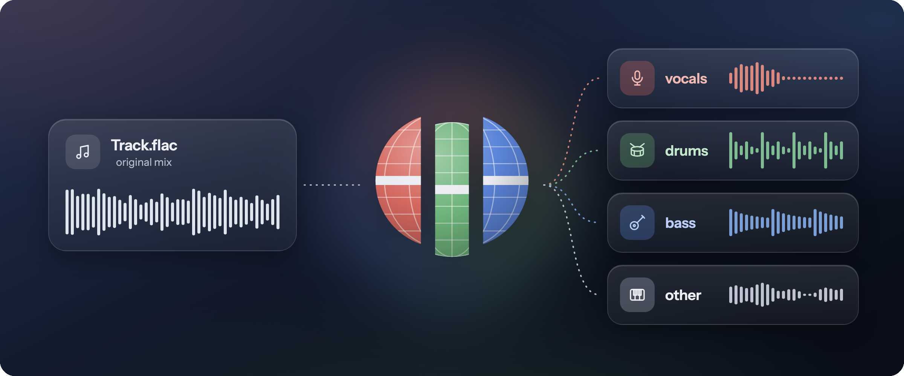
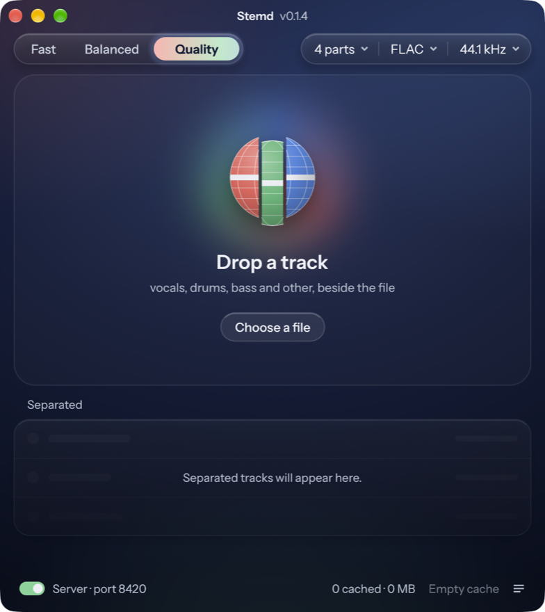

<div align="center">



# Stemd

**Split any track into stems, on your own machine.**


[Download for macOS](https://github.com/nsaintot/stemd/releases/latest) ·
[Windows](https://github.com/nsaintot/stemd/releases/latest) ·
[Linux](https://github.com/nsaintot/stemd/releases/latest)

</div>

---

## Introduction

Stemd separates a mixed track into its parts: vocals, drums, bass and the
rest of the music. It runs the models on your own GPU, Metal on Apple silicon
or CUDA on NVIDIA.

Stemd is two things in one program:

- **A desktop app.** Drop a file on the window and the stems appear in a
folder beside it.
- **A separation server.** Other machines on the network find it by mDNS and
send it audio over HTTP. A DJ player or a script on a small board can use
the GPU of the Mac or PC next to it.

<div align="center">



</div>

## Features

**In the window**

- Drop a track, or click to choose one. Stems land besides the track in `<track>-stems/`.
- Choose the parts: `harmonics`, `vocals` and `drums` by default, or split
`harmonics` into `bass` and `other`.
- FLAC, WAV, MP3 or raw PCM output, at 24, 44.1, 48 or 96 kHz.
- In any lossless format the stems sum back to the original track bit for bit.
- Three presets: Fast, Balanced and Quality. See [Presets](#presets).
- A running or queued drop can be stopped from its row.
- Built-in updates: Sparkle on macOS, a silent Setup on Windows, a notice on
Linux.

**As a server**

- Plain HTTP on port `8420`: raw PCM in, stems out. The contract is in
[docs/api.md](docs/api.md).
- Announces itself over mDNS as `_stemd._tcp`, so a client needs no address.
- `--headless` runs it without a window, on a desktop or a server.
- Sessions separate a track piece by piece around a playhead. A player can
start on the part under the needle before the whole track is done.
- One job queue and one cache for drops and clients. A track separated once is
a cache hit the next time, from a drop or a client.
- `model_id` in `/v1/health` names the exact weights and settings behind the
stems, so a client can key its own stem cache on it.
- The server switch in the status bar turns the API off without closing the
app.
- `stemd-cli` is the reference client:
  ```bash
  stemd-cli path/to/track.wav
  ```

## Install


| platform | download                                                                                               | needs                                           |
| -------- | ------------------------------------------------------------------------------------------------------ | ----------------------------------------------- |
| macOS    | [`stemd-<version>-macos-arm64.dmg`](https://github.com/nsaintot/stemd/releases/latest)                 | macOS 14 or later, Apple silicon                |
| Windows  | [`stemd-<version>-setup.exe`](https://github.com/nsaintot/stemd/releases/latest) or `-windows-x64.zip` | NVIDIA driver 580 or later, else CPU            |
| Linux    | [`.deb`, `.rpm`, `.AppImage`](https://github.com/nsaintot/stemd/releases/latest), x86\_64 or aarch64   | glibc 2.35 or later, NVIDIA driver 580 or later |


Every link opens the latest release. The first run downloads the model
weights, 168 MB to 942 MB depending on the preset.

**macOS.** Open the disk image and drag Stemd to Applications. The app is
signed and notarized, and the ticket is stapled, so the first launch needs no
network.

**Windows.** Run `setup.exe`. It installs for the current user without
administrator rights; the first page offers an install for all users. The zip
is for running without an installer.

For GPU separation, tick the CUDA box on the last page of the installer, or
run `install-cuda.cmd` later. It fetches about 1.2 GB of NVIDIA's runtime,
pinned by digest. Without it Stemd runs on the CPU, much slower.

**Linux.** Each package carries the CUDA runtime and cuDNN; the NVIDIA driver
is the only other requirement.


|                 |                                                   |
| --------------- | ------------------------------------------------- |
| Debian, Ubuntu  | `sudo apt install ./stemd-*-linux-x86_64.deb`     |
| Fedora, RHEL 10 | `sudo dnf install ./stemd-*-linux-x86_64.rpm`     |
| anything else   | `chmod +x stemd-*.AppImage && ./stemd-*.AppImage` |


Supported: Ubuntu 22.04, Debian 12, Fedora 36, RHEL 10 and later. The aarch64
build targets NVIDIA Arm machines such as DGX Spark and Grace Hopper, and
needs an NVIDIA GPU.

## Presets


| preset   | model          | download | drums     | bass     | other    | harmonics | vocals    | RTX 3090 Ti | M1 Pro |
| -------- | -------------- | -------- | --------- | -------- | -------- | --------- | --------- | ----------- | ------ |
| **Fast** | `htdemucs` v4  | 168 MB   | 8.27      | 8.17     | 5.14     | 8.62      | 8.92      | 106x        | 18x    |
| Balanced | `htdemucs_ft`  | 672 MB   | 8.49      | **8.40** | 5.20     | 8.78      | 9.28      | 55x         | 8x     |
| Quality  | stemd RoFormer | 251 MB   | **11.07** | 7.97     | **6.52** | **11.54** | **11.34** | 18x         | 3.6x   |


- Parts: SDR in dB, higher is better. Global SDR over the first 12 MUSDB18-HQ
test tracks, full length, from the shipped server. `drums` is rebuilt from the
mix, as the window writes it.
- Speed: times realtime on a warm 64 s clip. The first separation after launch
takes about twice as long while the GPU kernels compile.
- Fast is the default. It won a listening test on real material against the
other two.

Method and notes: [docs/evaluation.md](docs/evaluation.md#every-preset-per-part).

## Where things go


|        |                                                        |
| ------ | ------------------------------------------------------ |
| stems  | `<track>-stems/`, beside the track                     |
| models | the user data directory, downloaded once               |
| cache  | recent results, capped at 4 GB, emptied at every start |


Repeating a track already separated returns the cached result: entries are keyed
by the audio and by everything else that changes the output.

## Build from source

Needs `cmake`, Rust 1.89 or later, and a recursive clone. Per-platform
toolchains, packaging and every flag are in
[docs/building.md](docs/building.md).

```bash
git clone --recurse-submodules https://github.com/nsaintot/stemd
cargo build --release
```

## Documentation


|                                          |                                                |
| ---------------------------------------- | ---------------------------------------------- |
| [docs/building.md](docs/building.md)     | building, packaging and every flag             |
| [docs/api.md](docs/api.md)               | the HTTP contract for writing a client         |
| [docs/internals.md](docs/internals.md)   | cache, queue, discovery, model loading         |
| [docs/evaluation.md](docs/evaluation.md) | how the models were chosen and measured        |
| [docs/models.md](docs/models.md)         | where the weights come from, and their licence |


## License

Dual-licensed under [MIT](LICENSE-MIT) and [Apache-2.0](LICENSE-APACHE). Use
whichever of the two you prefer.

The model weights are not covered by either and state their own terms; see the
[models-v2](https://github.com/nsaintot/stemd/releases/tag/models-v2) and
[models-v3](https://github.com/nsaintot/stemd/releases/tag/models-v3) releases.
`stemd_roformer`, which Quality runs, is CC BY-NC 4.0.

The MP3 encoder is LAME 3.100, which is under the GNU Library General Public
License version 2 and links statically, so redistributing a built binary carries
that obligation.

`crates/stemd-core/data/mode1_*.bin` are measurements of third-party hardware
rather than authored code, so the grant above does not purport to cover them.
They are used for one conversion, 44.1 to 96 kHz, and only when a request asks
for it, so that a client subtracting stems from its own mix gets the same filter
on both sides.